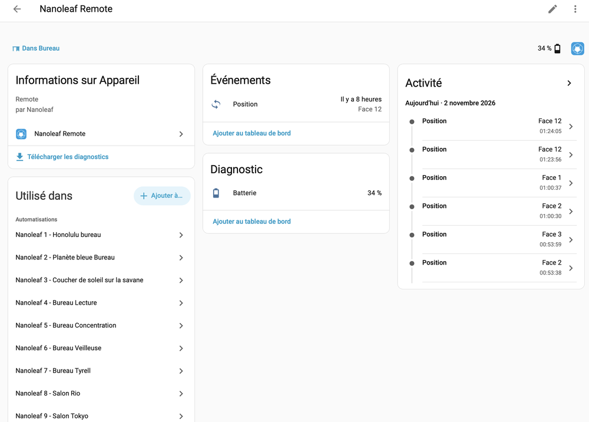
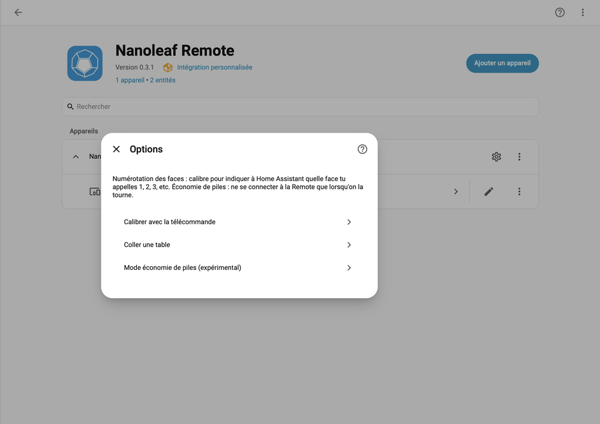

# Nanoleaf Remote for Home Assistant

[](https://github.com/Jeromearsene/nanoleaf-remote-HA/actions/workflows/ci.yml)
[](https://github.com/Jeromearsene/nanoleaf-remote-HA/actions/workflows/validate.yml)
[](https://github.com/Jeromearsene/nanoleaf-remote-HA/releases)
[](https://hacs.xyz)
[](https://www.home-assistant.io)
[](https://github.com/Jeromearsene/nanoleaf-remote-HA/commits/main)
[](https://github.com/Jeromearsene/nanoleaf-remote-HA/issues)
[](LICENSE)

🇬🇧 English (this document) | 🇫🇷 [Français](README.fr.md)

Use the **Nanoleaf Remote** (the 12-sided HomeKit remote) in Home Assistant **without Apple Home**: turn it onto a face and Home Assistant gets an event you can use in automations.

It talks to the Remote directly through Home Assistant's own Bluetooth (local adapter or ESPHome Bluetooth proxy). No MQTT broker, no Apple device, no Thread border router.

> **Disclaimer**: independent project, not affiliated with Apple or Nanoleaf, provided as is. It uses a home-made implementation of the HomeKit Accessory Protocol over Bluetooth LE that has had **no independent security audit**. See [`SECURITY.md`](SECURITY.md).

## Screenshots

The device page: the **Position** event entity (last face turned), the **Battery** sensor and the automations that use the Remote (French interface shown).



The **Configure** dialog: face calibration, pasting a face table, and the experimental battery saving mode.



## Features

- Setup from the UI: Bluetooth discovery, pairing with the 8-digit HomeKit code, or reuse of an existing pairing.
- One **Event** entity with event types `face_1` … `face_12`.
- One **Battery** sensor, read from the Remote itself (if it exposes that HomeKit service).
- Automatic reconnection; the entity is unavailable while the Remote is out of reach.
- Guided **calibration** of the face numbering (you choose which face is 1, 2, 3…).
- Several Remotes supported, English and French interface.

## Requirements

- Home Assistant 2025.1 or newer with a working Bluetooth adapter (or an ESPHome Bluetooth proxy) within range of the Remote.
- [HACS](https://hacs.xyz).
- A Nanoleaf Remote with 2 AA batteries, **removed from Apple Home** (it accepts a single controller).

## Installation

1. In HACS, open ⋮ → **Custom repositories**, add `https://github.com/Jeromearsene/nanoleaf-remote-HA` with type **Integration**, then **Download** *Nanoleaf Remote* (or use the button: [](https://my.home-assistant.io/redirect/hacs_repository/?owner=Jeromearsene&repository=nanoleaf-remote-HA&category=integration)).
2. Restart Home Assistant.
3. In **Settings → Devices & services**, the Remote may appear under *Discovered*; otherwise **Add integration → Nanoleaf Remote**.
4. Choose **Pair with the setup code** and enter the 8-digit code printed on the Remote. Press Submit, then **turn the Remote continuously** for a few seconds: it only advertises while awake, and Home Assistant waits up to 30 s for it.

### Already paired with the `hapble` tools?

If you ran the research tools and have a `pairing.json`, the Remote is still paired with it and refuses a second pairing. Choose **Reuse an existing pairing** and paste the content of `pairing.json`. Home Assistant checks it against the Remote first. Do not run the tools on the same Remote at the same time (it accepts one connection).

## Using it

The integration creates a device with an event entity (for example `event.nanoleaf_remote_position`; check the exact id in your entities) and a battery sensor (`sensor.nanoleaf_remote_battery`). Each time you turn the Remote onto a face, the entity records an event `face_N`. The battery sensor is read once per connection (and every 30 minutes while the permanent connection is used) and stays unavailable if the Remote does not expose a Battery service.

```yaml
automation:
  - alias: "Remote face 3 → evening scene"
    triggers:
      - trigger: state
        entity_id: event.nanoleaf_remote_position
        attribute: event_type
        to: face_3
    actions:
      - action: scene.turn_on
        target:
          entity_id: scene.evening
```

### Calibrating the faces

The Remote reports its faces in its own internal order, which may not match the numbering you expect. Open **Settings → Devices & services → Nanoleaf Remote → Configure**:

- **Calibrate with the Remote**: for each face, turn the Remote onto it, wait a second, press Submit. Start with the face you want to call 1 and follow the same order for the others. Automations are paused meanwhile.
- **Paste a table**: 12 comma-separated numbers, the Nth being the real face for the Nth detected position (the table printed by `poetry run calibrate`).

### Battery saving mode (experimental)

By default Home Assistant stays connected to the Remote and reads it every 1.5 s. In **Configure → Battery saving mode (experimental)** it can instead listen to the Remote's Bluetooth advertisements and connect only when it is turned (like Apple Home does), then let go after 10 s without activity. Expect 2–3 s of latency, and it needs a Bluetooth adapter that hears the Remote when it is awake. It should be lighter on the batteries, but this has not been measured yet: please report what you see. Turn it off to go back to the permanent connection.

## Troubleshooting

| Symptom | What to check |
| --- | --- |
| "Not heard by Home Assistant Bluetooth" | The Remote only advertises while awake: press Submit then turn it continuously, close to the adapter. Check the *Advertisement monitor* of the Bluetooth integration. |
| "Refuses new pairings" | It is still paired elsewhere (Apple Home, or the `hapble` tools). Remove it there, or use **Reuse an existing pairing**. |
| "Pairing rejected" on import | The Remote no longer knows that pairing (for example after a reset). Pair with the setup code instead. |
| Remote blinks or never lights up | Two fresh AA batteries, one inserted each way as marked. It must light up when the cover closes and change colour when turned. Last resort: press the reset button on the battery housing with a pin, then pair again. |
| Wrong face number | Run the calibration (above). Since 0.3.1 the numbering stays the same after a restart; if you calibrated with an earlier version, calibrate once more. |

Enable debug logs with `logger: logs: custom_components.nanoleaf_remote: debug` and attach them (without secrets) to an issue. The diagnostics download redacts the pairing keys.

## How it works

The Remote is a HomeKit Bluetooth accessory with 12 *programmable switch* instances. The integration pairs once (HomeKit Pair-Setup), then connects through Home Assistant's Bluetooth, verifies the pairing (Pair-Verify) and reads the switch characteristics every 1.5 s, which also keeps the connection alive (the Remote drops idle connections after ~5 s). The protocol code lives in [`hapble/`](hapble/) and is vendored into `custom_components/nanoleaf_remote/hapble/` (HACS only installs that folder). The reverse-engineering story is in [`docs/hapble.md`](docs/hapble.md).

## Known limitations

- The Remote accepts **one controller at a time**: it cannot stay in Apple Home and Home Assistant together.
- It only advertises while awake, so it must be paired and (re)connected while you turn it.
- Tested on one real Remote so far: please report what you see on yours.
- The protocol implementation is home-made and has had no independent security audit.

## Removing the integration

Delete the entry in **Settings → Devices & services → Nanoleaf Remote**, then (optional) remove the repository from HACS. The Remote stays paired with Home Assistant's keys until you reset it (reset button in the battery housing, see Troubleshooting), after which it can be paired with Apple Home or another controller again.

## Security

Pairing keys are stored in the Home Assistant config entry, in **unencrypted** `.storage/`. Protect your configuration directory and backups. Details and vulnerability reporting: [`SECURITY.md`](SECURITY.md).

## Alternative: MQTT bridge

If Home Assistant cannot reach the Remote by Bluetooth, a standalone bridge can run on another machine and publish events over MQTT: see [`docs/hapble.md`](docs/hapble.md#running-the-mqtt-bridge-phase-6).

## Contributing

See [`CONTRIBUTING.md`](CONTRIBUTING.md). Release history: [`CHANGELOG.md`](CHANGELOG.md).

## Star History

[](https://star-history.com/#Jeromearsene/nanoleaf-remote-HA&Date)

## License

[MIT](LICENSE). Parts of the protocol layer derive from [pyhomekit](https://github.com/henridwyer/pyhomekit) (MIT): see [`THIRD_PARTY_NOTICES.md`](THIRD_PARTY_NOTICES.md).
